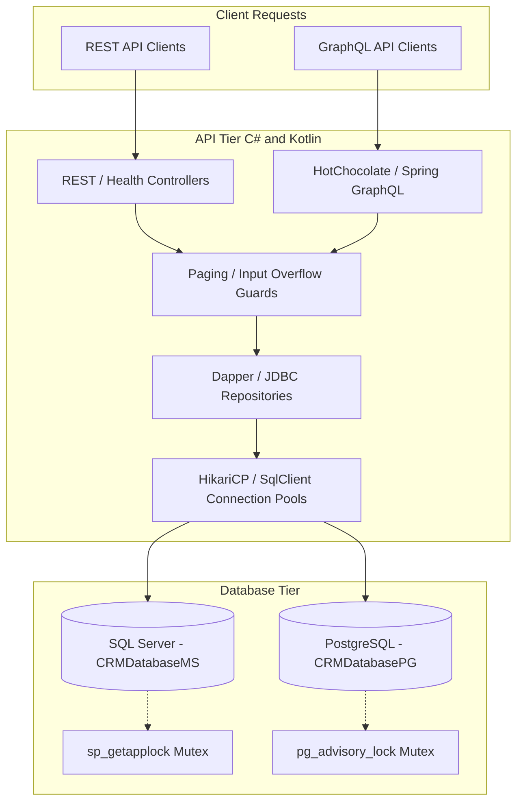

# Requirements

### Overview & Goals
The workspace contains a catalog of operational and architectural issues in [ISSUES.md](air-file://nmtkpi7uqs88prg7f8tn/Users/cy/codes/localstack-reference-architecture/local/ISSUES.md?type=file&root=%252F) across security exposure, resource management, runtime race conditions, and developer tooling. The goal of this plan is to systematically eliminate these defects, establishing robust concurrency guarantees, production-ready connection management, defensive arithmetic, and secure infrastructure defaults.

### Scope
- **In Scope**:
  - PostgreSQL migration runner interpolation bug in [migrate.py](air-file://nmtkpi7uqs88prg7f8tn/Users/cy/codes/localstack-reference-architecture/CRMDatabasePG/migrate.py?type=file&root=%252F) and concurrency locking (`pg_advisory_lock`) in [migrate.sh](air-file://nmtkpi7uqs88prg7f8tn/Users/cy/codes/localstack-reference-architecture/CRMDatabasePG/migrate.sh?type=file&root=%252F).
  - SQL Server seed transaction atomicity and application-level lock synchronization (`sp_getapplock`) in [sp_SeedStandardData.sql](air-file://nmtkpi7uqs88prg7f8tn/Users/cy/codes/localstack-reference-architecture/CRMDatabaseMS/CRMDatabaseMS/StoredProcedures/sp_SeedStandardData.sql?type=file&root=%252F).
  - Health check gating in [compose.yaml](air-file://nmtkpi7uqs88prg7f8tn/Users/cy/codes/localstack-reference-architecture/crm-infra/compose.yaml?type=file&root=%252F) to prevent API containers from starting prior to schema completion.
  - Kotlin connection pooling (HikariCP), query/connection timeouts, and credential parsing fixes in [DbConnectionFactory.kt](air-file://nmtkpi7uqs88prg7f8tn/Users/cy/codes/localstack-reference-architecture/CrmApiKotlinSpringBoot/src/main/kotlin/codes/cy/crmapi/infrastructure/connections/DbConnectionFactory.kt?type=file&root=%252F) and [JdbcDataMapper.kt](air-file://nmtkpi7uqs88prg7f8tn/Users/cy/codes/localstack-reference-architecture/CrmApiKotlinSpringBoot/src/main/kotlin/codes/cy/crmapi/infrastructure/repositories/JdbcDataMapper.kt?type=file&root=%252F).
  - Kotlin clean architecture fitness tests using ArchUnit.
  - 32-bit integer overflow protection for paging arithmetic across C# and Kotlin repositories.
  - GraphQL execution depth protection in C# [Program.cs](air-file://nmtkpi7uqs88prg7f8tn/Users/cy/codes/localstack-reference-architecture/CrmApiCSharp/src/Api/Program.cs?type=file&root=%252F).
  - Safe bounds on child relationship list queries in [BaseRepository.cs](air-file://nmtkpi7uqs88prg7f8tn/Users/cy/codes/localstack-reference-architecture/CrmApiCSharp/src/Infrastructure/Repositories/BaseRepository.cs?type=file&root=%252F).
  - IAM secrets policy dependency ordering in [ecs-service/main.tf](air-file://nmtkpi7uqs88prg7f8tn/Users/cy/codes/localstack-reference-architecture/crm-infra/terraform/modules/aws/ecs-service/main.tf?type=file&root=%252F).
  - Parameterized RDS deletion protection and snapshot configuration in [rds-database/main.tf](air-file://nmtkpi7uqs88prg7f8tn/Users/cy/codes/localstack-reference-architecture/crm-infra/terraform/modules/aws/rds-database/main.tf?type=file&root=%252F).
  - Parameterized database ingress rules in Terraform for secure cloud deployments.
- **Out of Scope**:
  - Implementing full OAuth2 / JWT perimeter authentication infrastructure (covered under future identity provider integration milestone).
  - Introducing write paths (INSERT/UPDATE/DELETE endpoints remain read-only in accordance with current architecture).

### User Stories
- As a **DevOps / Cloud Engineer**, I want database migrations and seeds to execute with advisory locks and schema-readiness gating so that automated deployments never fail due to race conditions or incomplete schemas.
- As a **Backend Engineer**, I want the Kotlin Spring Boot API to use a pooled `HikariDataSource` with strict timeouts so that concurrent requests do not exhaust JVM threads or database connections.
- As an **API Consumer**, I want query pagination and nested GraphQL operations to be protected against integer overflows and combinatorial query attacks so that the service remains reliable and responsive.

### Functional Requirements
- `FR-1`: PostgreSQL migrations executed via `migrate.py` or `migrate.sh` must interpolate SQL variables without syntax errors and execute under an advisory lock.
- `FR-2`: SQL Server data seeding must acquire an exclusive application lock (`sp_getapplock`) and run table cleanup and record insertion inside a single transaction.
- `FR-3`: Docker Compose database health checks must verify that migrations and seeds are complete before marking database containers as healthy.
- `FR-4`: Kotlin database connections must be pooled using HikariCP, honouring configured usernames/passwords for both ADO.NET and JDBC connection string formats.
- `FR-5`: Paging requests with large page indices (e.g. `page=2147483647`) must be rejected with HTTP 400 Bad Request or safely clamped, preventing integer wraparound.
- `FR-6`: GraphQL endpoints must reject queries exceeding maximum execution depth (depth limit 10).
- `FR-7`: Terraform ECS task definitions and services must explicitly depend on the IAM secrets retrieval policy to eliminate startup initialization races.

### Non-Functional Requirements
- **Reliability & Availability**: Eliminate deadlocks and race conditions during continuous deployment and automated local testing.
- **Performance & Resource Utilization**: Bounded connection pools and query timeouts prevent thread starvation and memory exhaustion under high concurrency.
- **Security Compliance**: Real-cloud Terraform templates must default to private database subnets and verified TLS enforcement.

# Technical Design

### Current Implementation
- **PostgreSQL Migrator**: [migrate.py](air-file://nmtkpi7uqs88prg7f8tn/Users/cy/codes/localstack-reference-architecture/CRMDatabasePG/migrate.py?type=file&root=%252F) passes SQL via `psql -c`, which does not interpolate `:'mig_version'`, causing `is_migration_applied` to fail and subsequent migrations to crash on duplicate inserts.
- **SQL Server Seeding**: [sp_SeedStandardData.sql](air-file://nmtkpi7uqs88prg7f8tn/Users/cy/codes/localstack-reference-architecture/CRMDatabaseMS/CRMDatabaseMS/StoredProcedures/sp_SeedStandardData.sql?type=file&root=%252F) executes cleanup outside the transaction without locking, allowing concurrent seeds to interleave and fail.
- **Kotlin Persistence**: [DbConnectionFactory.kt](air-file://nmtkpi7uqs88prg7f8tn/Users/cy/codes/localstack-reference-architecture/CrmApiKotlinSpringBoot/src/main/kotlin/codes/cy/crmapi/infrastructure/connections/DbConnectionFactory.kt?type=file&root=%252F) creates unpooled connections via `DriverManager.getConnection` on every request and defaults credentials for raw `jdbc:` URLs.
- **Paging Offsets**: [QueryFilteringExtensions.cs](air-file://nmtkpi7uqs88prg7f8tn/Users/cy/codes/localstack-reference-architecture/CrmApiCSharp/src/Infrastructure/Repositories/QueryFilteringExtensions.cs?type=file&root=%252F) and [QueryFilteringExtensions.kt](air-file://nmtkpi7uqs88prg7f8tn/Users/cy/codes/localstack-reference-architecture/CrmApiKotlinSpringBoot/src/main/kotlin/codes/cy/crmapi/infrastructure/repositories/QueryFilteringExtensions.kt?type=file&root=%252F) compute `(page - 1) * pageSize` in raw 32-bit `Int`, wrapping negative on large inputs.
- **Terraform ECS Service**: [ecs-service/main.tf](air-file://nmtkpi7uqs88prg7f8tn/Users/cy/codes/localstack-reference-architecture/crm-infra/terraform/modules/aws/ecs-service/main.tf?type=file&root=%252F) does not declare `depends_on = [aws_iam_role_policy.read_secrets]`, creating race conditions during initial task launch.

### Key Decisions
- **Advisory & Application Locking**: Use PostgreSQL `pg_advisory_lock(hashtext('crm_migration_lock'))` and SQL Server `sp_getapplock` (`@Resource = 'CRM_Seed_Lock'`) to provide database-native distributed synchronization without external lock managers.
- **HikariCP for JVM Pooling**: Back Kotlin's `IDbConnectionFactory` with `HikariDataSource` instances keyed by `DatabaseProvider`. HikariCP is the JVM industry benchmark for connection pooling and integrates natively with Spring Boot.
- **Defensive Paging Arithmetic**: Enforce `MaxPage = 100000` in `QueryOptions` and perform offset calculations in `Long` / `checked` blocks, returning HTTP 400 when out of bounds.
- **GraphQL Depth Limiting**: Configure HotChocolate's `AddMaxExecutionDepth(10)` in C# to prevent nested combinatorial denial-of-service queries.

### Proposed Changes

#### Database Migrations & Seeding
- Refactor `run_psql` in [migrate.py](air-file://nmtkpi7uqs88prg7f8tn/Users/cy/codes/localstack-reference-architecture/CRMDatabasePG/migrate.py?type=file&root=%252F) to pass queries via `input=sql` (standard input stream) so `psql -v` variable substitution functions properly.
- Wrap migration iterations in [migrate.sh](air-file://nmtkpi7uqs88prg7f8tn/Users/cy/codes/localstack-reference-architecture/CRMDatabasePG/migrate.sh?type=file&root=%252F) with `SELECT pg_advisory_lock(hashtext('crm_migration_lock'));` and `SELECT pg_advisory_unlock(hashtext('crm_migration_lock'));`.
- Update [sp_SeedStandardData.sql](air-file://nmtkpi7uqs88prg7f8tn/Users/cy/codes/localstack-reference-architecture/CRMDatabaseMS/CRMDatabaseMS/StoredProcedures/sp_SeedStandardData.sql?type=file&root=%252F) to call `sp_getapplock` with `@LockMode = 'Exclusive'`, executing `sp_CleanupAllCRMData` and all inserts inside a single `TRY/CATCH` transaction.

#### Kotlin API Infrastructure
- In [build.gradle.kts](air-file://nmtkpi7uqs88prg7f8tn/Users/cy/codes/localstack-reference-architecture/CrmApiKotlinSpringBoot/build.gradle.kts?type=file&root=%252F), add `com.zaxxer:HikariCP` and `com.tngtech.archunit:archunit-junit5`.
- In [DbConnectionFactory.kt](air-file://nmtkpi7uqs88prg7f8tn/Users/cy/codes/localstack-reference-architecture/CrmApiKotlinSpringBoot/src/main/kotlin/codes/cy/crmapi/infrastructure/connections/DbConnectionFactory.kt?type=file&root=%252F), initialize a `ConcurrentHashMap<DatabaseProvider, HikariDataSource>` with properties for `maximumPoolSize = 10`, `connectionTimeout = 5000`, and `idleTimeout = 600000`. Parse `user` and `password` parameters out of raw `jdbc:` URLs when present.
- In [JdbcDataMapper.kt](air-file://nmtkpi7uqs88prg7f8tn/Users/cy/codes/localstack-reference-architecture/CrmApiKotlinSpringBoot/src/main/kotlin/codes/cy/crmapi/infrastructure/repositories/JdbcDataMapper.kt?type=file&root=%252F), set `statement.queryTimeout = 30`.
- In [application.yml](air-file://nmtkpi7uqs88prg7f8tn/Users/cy/codes/localstack-reference-architecture/CrmApiKotlinSpringBoot/src/main/resources/application.yml?type=file&root=%252F), remove the unused `crm.databases.*` block.

#### API Security & Query Boundaries
- In [Program.cs](air-file://nmtkpi7uqs88prg7f8tn/Users/cy/codes/localstack-reference-architecture/CrmApiCSharp/src/Api/Program.cs?type=file&root=%252F), append `.AddMaxExecutionDepth(10)` and `.SetPagingOptions(new PagingOptions { MaxPageSize = 100 })` to `.AddGraphQLServer()`.
- In [QueryOptions.cs](air-file://nmtkpi7uqs88prg7f8tn/Users/cy/codes/localstack-reference-architecture/CrmApiCSharp/src/Domain/Common/QueryOptions.cs?type=file&root=%252F) and [QueryOptions.kt](air-file://nmtkpi7uqs88prg7f8tn/Users/cy/codes/localstack-reference-architecture/CrmApiKotlinSpringBoot/src/main/kotlin/codes/cy/crmapi/domain/common/QueryOptions.kt?type=file&root=%252F), define `const val MaxPage: Int = 100_000` and validate that `Page <= MaxPage`.
- In [BaseRepository.cs](air-file://nmtkpi7uqs88prg7f8tn/Users/cy/codes/localstack-reference-architecture/CrmApiCSharp/src/Infrastructure/Repositories/BaseRepository.cs?type=file&root=%252F), add `query.Limit(MaxChildResults)` in `GetListAsync`.

#### Infrastructure & Deployment
- In [ecs-service/main.tf](air-file://nmtkpi7uqs88prg7f8tn/Users/cy/codes/localstack-reference-architecture/crm-infra/terraform/modules/aws/ecs-service/main.tf?type=file&root=%252F), update `aws_ecs_service.this` `depends_on` to include `aws_iam_role_policy.read_secrets`.
- In [rds-database/main.tf](air-file://nmtkpi7uqs88prg7f8tn/Users/cy/codes/localstack-reference-architecture/crm-infra/terraform/modules/aws/rds-database/main.tf?type=file&root=%252F), expose `skip_final_snapshot` (default `true` for local, configurable) and `deletion_protection` (default `false` for local, configurable).
- In [compose.yaml](air-file://nmtkpi7uqs88prg7f8tn/Users/cy/codes/localstack-reference-architecture/crm-infra/compose.yaml?type=file&root=%252F), update health checks to verify that table `public.schema_version` contains recorded migrations.

### Architecture Diagram

### Risks
- **HikariCP Lifecycle in Tests**: In-memory test suites recreating application contexts must ensure `HikariDataSource.close()` is invoked to prevent connection leaks. Handled via Spring's `DisposableBean` lifecycle.
- **Advisory Lock Cleanup on Crash**: If a migration script crashes abruptly, session-level advisory locks in PostgreSQL automatically release upon connection termination, avoiding permanent deadlocks.

# Testing

### Validation Approach
Verification combines automated unit tests, architecture rule assertions, integration test suites, and Docker container startup validation.

### Key Scenarios
- **Migration & Seeding Idempotency**:
  - Execute `migrate.py` and `migrate.sh` against clean and pre-seeded PostgreSQL instances, confirming exit code 0 and proper `schema_version` entries without syntax errors.
  - Run concurrent executions of `sp_SeedStandardData` on SQL Server, verifying that execution locks serialize runs without primary key collisions.
- **Connection Pooling & Timeout Validation**:
  - Verify that `DbConnectionFactory` in Kotlin returns connections from a pooled `HikariDataSource`.
  - Simulate an unreachable or delayed database endpoint and verify that `connectionTimeout` and `queryTimeout` fail fast rather than hanging indefinitely.
- **Paging Overflow & Bounds Checking**:
  - Issue REST and GraphQL requests with `page=2147483647` and `pageSize=100`, verifying that the API returns HTTP 400 Bad Request or a clamped safe query rather than a SQL syntax/overflow error (500).
- **GraphQL Depth Limiting**:
  - Issue deeply nested GraphQL queries (>10 levels) to `CrmApiCSharp`, verifying that HotChocolate rejects the request with an execution depth error before evaluating queries.
- **Clean Architecture Fitness**:
  - Run ArchUnit tests in `CrmApiKotlinSpringBoot` to ensure zero illegal dependency references across `domain`, `application`, `infrastructure`, and `api`.

### Test Changes
- **Add** `ArchitectureBoundaryTests.kt` in `CrmApiKotlinSpringBoot` using ArchUnit.
- **Add** unit tests in `QueryFilteringExtensionsTests` for extreme `page` and `pageSize` boundary values.
- **Add** GraphQL depth limit tests in `GraphQLEndpointTests.cs`.
- **Execute** `./verify_all_pipelines.sh` to validate all pipelines end-to-end.

# Delivery Steps

### ✓ Step 1: Resolve Database Migrator, Seed Concurrency, and Startup Ordering Defects
Eliminate database migration failures, startup races, and seeder concurrency bugs across PostgreSQL and SQL Server.

- Fix [migrate.py](air-file://nmtkpi7uqs88prg7f8tn/Users/cy/codes/localstack-reference-architecture/CRMDatabasePG/migrate.py?type=file&root=%252F) by passing parameterized SQL statements through standard input (`input=sql`) so `psql` correctly interpolates `:'mig_version'` and other variables.
- Update [migrate.sh](air-file://nmtkpi7uqs88prg7f8tn/Users/cy/codes/localstack-reference-architecture/CRMDatabasePG/migrate.sh?type=file&root=%252F) to acquire a global `pg_advisory_lock` for the duration of the migration run and insert the `schema_version` record within the migration transaction.
- Add a bounded `pg_isready` connection retry loop in [migrate.sh](air-file://nmtkpi7uqs88prg7f8tn/Users/cy/codes/localstack-reference-architecture/CRMDatabasePG/migrate.sh?type=file&root=%252F) to prevent failure when RDS or Flexible Server DNS/network readiness lags behind Terraform resource creation.
- Update [sp_SeedStandardData.sql](air-file://nmtkpi7uqs88prg7f8tn/Users/cy/codes/localstack-reference-architecture/CRMDatabaseMS/CRMDatabaseMS/StoredProcedures/sp_SeedStandardData.sql?type=file&root=%252F) to acquire an application lock via `sp_getapplock` and execute cleanup and seeding within an atomic transaction.
- Update database health checks in [compose.yaml](air-file://nmtkpi7uqs88prg7f8tn/Users/cy/codes/localstack-reference-architecture/crm-infra/compose.yaml?type=file&root=%252F) to query table schema readiness (`schema_version` / seeded table) rather than raw socket connection (`SELECT 1`), ensuring API containers only start when databases are fully seeded.
- Add unique constraint on HubSpot Contact email in [Contact.sql](air-file://nmtkpi7uqs88prg7f8tn/Users/cy/codes/localstack-reference-architecture/CRMDatabaseMS/CRMDatabaseMS/HubSpot/Tables/Contact.sql?type=file&root=%252F) and a new PostgreSQL migration.

### ✓ Step 2: Implement JVM Connection Pooling, Resilient Timeouts, and Architecture Testing in Kotlin
Transition Kotlin persistence from unpooled DriverManager connections to pooled HikariCP data sources with timeout controls, clean up configuration, and enforce architectural boundaries.

- Introduce HikariCP dependency (`com.zaxxer:HikariCP`) in [build.gradle.kts](air-file://nmtkpi7uqs88prg7f8tn/Users/cy/codes/localstack-reference-architecture/CrmApiKotlinSpringBoot/build.gradle.kts?type=file&root=%252F).
- Refactor [DbConnectionFactory.kt](air-file://nmtkpi7uqs88prg7f8tn/Users/cy/codes/localstack-reference-architecture/CrmApiKotlinSpringBoot/src/main/kotlin/codes/cy/crmapi/infrastructure/connections/DbConnectionFactory.kt?type=file&root=%252F) to manage cached `HikariDataSource` instances per `DatabaseProvider`, configuring connection timeouts, idle timeouts, and maximum pool sizes.
- Fix raw `jdbc:` URL credential extraction in [DbConnectionFactory.kt](air-file://nmtkpi7uqs88prg7f8tn/Users/cy/codes/localstack-reference-architecture/CrmApiKotlinSpringBoot/src/main/kotlin/codes/cy/crmapi/infrastructure/connections/DbConnectionFactory.kt?type=file&root=%252F) so custom usernames and passwords are not overwritten by hardcoded defaults.
- Remove dead `crm.databases.*` configuration block from [application.yml](air-file://nmtkpi7uqs88prg7f8tn/Users/cy/codes/localstack-reference-architecture/CrmApiKotlinSpringBoot/src/main/resources/application.yml?type=file&root=%252F) and bind database connection strings cleanly through typed properties.
- Configure `statement.queryTimeout` in [JdbcDataMapper.kt](air-file://nmtkpi7uqs88prg7f8tn/Users/cy/codes/localstack-reference-architecture/CrmApiKotlinSpringBoot/src/main/kotlin/codes/cy/crmapi/infrastructure/repositories/JdbcDataMapper.kt?type=file&root=%252F) to prevent hung queries from holding JVM threads indefinitely.
- Add ArchUnit test suite (`com.tngtech.archunit:archunit-junit5`) in [CrmApiKotlinSpringBoot](air-file://nmtkpi7uqs88prg7f8tn/Users/cy/codes/localstack-reference-architecture/CrmApiKotlinSpringBoot/build.gradle.kts?type=file&root=%252F) to assert package boundary compliance (`domain` isolation, `application` separation).

### ✓ Step 3: Harden Paging Arithmetic, GraphQL Complexity Limits, and Repository Safeguards
Protect both C# and Kotlin API runtimes against arithmetic overflows, unbounded child queries, deep GraphQL query exhaustion, and missing configuration failures.

- Add overflow protection for `(page - 1) * pageSize` calculation in [QueryFilteringExtensions.cs](air-file://nmtkpi7uqs88prg7f8tn/Users/cy/codes/localstack-reference-architecture/CrmApiCSharp/src/Infrastructure/Repositories/QueryFilteringExtensions.cs?type=file&root=%252F) and [QueryFilteringExtensions.kt](air-file://nmtkpi7uqs88prg7f8tn/Users/cy/codes/localstack-reference-architecture/CrmApiKotlinSpringBoot/src/main/kotlin/codes/cy/crmapi/infrastructure/repositories/QueryFilteringExtensions.kt?type=file&root=%252F), validating `page` against `MaxPage` in [QueryOptions.cs](air-file://nmtkpi7uqs88prg7f8tn/Users/cy/codes/localstack-reference-architecture/CrmApiCSharp/src/Domain/Common/QueryOptions.cs?type=file&root=%252F) and [QueryOptions.kt](air-file://nmtkpi7uqs88prg7f8tn/Users/cy/codes/localstack-reference-architecture/CrmApiKotlinSpringBoot/src/main/kotlin/codes/cy/crmapi/domain/common/QueryOptions.kt?type=file&root=%252F).
- Enforce GraphQL query depth and complexity limits (`AddMaxExecutionDepth(10)`) in C# [Program.cs](air-file://nmtkpi7uqs88prg7f8tn/Users/cy/codes/localstack-reference-architecture/CrmApiCSharp/src/Api/Program.cs?type=file&root=%252F).
- Add safety bounds and default limits (`MaxChildRecords = 1000`) on child collection queries in [BaseRepository.cs](air-file://nmtkpi7uqs88prg7f8tn/Users/cy/codes/localstack-reference-architecture/CrmApiCSharp/src/Infrastructure/Repositories/BaseRepository.cs?type=file&root=%252F).
- Implement startup configuration validation (`ValidateOnStart` in .NET, `@Validated` configuration properties in Spring Boot) to fail fast on invalid or missing connection strings when outside the local profile.
- Segregate liveness (`/health`) from database readiness probes (`/health/ms`, `/health/pg`) in [HealthController.cs](air-file://nmtkpi7uqs88prg7f8tn/Users/cy/codes/localstack-reference-architecture/CrmApiCSharp/src/Api/Controllers/HealthController.cs?type=file&root=%252F) and [HealthController.kt](air-file://nmtkpi7uqs88prg7f8tn/Users/cy/codes/localstack-reference-architecture/CrmApiKotlinSpringBoot/src/main/kotlin/codes/cy/crmapi/api/controllers/HealthController.kt?type=file&root=%252F).

### ✓ Step 4: Enforce Real-Cloud Security Defaults and Infrastructure Orchestration in Terraform
Harden Terraform infrastructure modules for production security, zero-data-loss defaults, and IAM policy synchronization.

- Fix ECS task startup race in [ecs-service/main.tf](air-file://nmtkpi7uqs88prg7f8tn/Users/cy/codes/localstack-reference-architecture/crm-infra/terraform/modules/aws/ecs-service/main.tf?type=file&root=%252F) by adding `depends_on = [aws_iam_role_policy.read_secrets]` to ensure IAM permissions propagate before task launch.
- Parameterize `skip_final_snapshot` and `deletion_protection` in [rds-database/main.tf](air-file://nmtkpi7uqs88prg7f8tn/Users/cy/codes/localstack-reference-architecture/crm-infra/terraform/modules/aws/rds-database/main.tf?type=file&root=%252F), providing safe defaults for cloud deployments.
- Parameterize database ingress CIDRs and firewall rules in AWS and Azure Terraform modules ([variables.tf](air-file://nmtkpi7uqs88prg7f8tn/Users/cy/codes/localstack-reference-architecture/crm-infra/terraform/aws/variables.tf?type=file&root=%252F), [azure/variables.tf](air-file://nmtkpi7uqs88prg7f8tn/Users/cy/codes/localstack-reference-architecture/crm-infra/terraform/azure/variables.tf?type=file&root=%252F)), enabling private subnets and restricting open ingress (`0.0.0.0/0`) on real cloud environments.
- Add HTTPS listener support and strict TLS verification options (`TrustServerCertificate=False`, `SSL Mode=VerifyFull`) in [crm-runtime-config](air-file://nmtkpi7uqs88prg7f8tn/Users/cy/codes/localstack-reference-architecture/crm-infra/terraform/modules/shared/crm-runtime-config/main.tf?type=file&root=%252F).
- Update the status tracking checklist in [ISSUES.md](air-file://nmtkpi7uqs88prg7f8tn/Users/cy/codes/localstack-reference-architecture/local/ISSUES.md?type=file&root=%252F).
